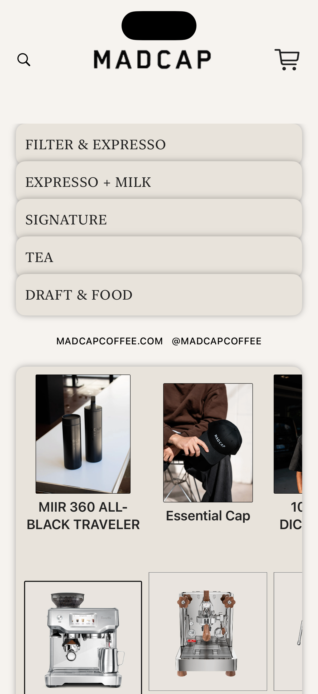
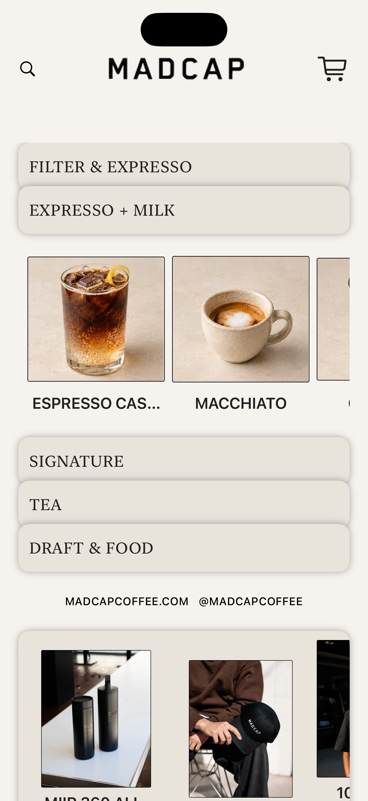
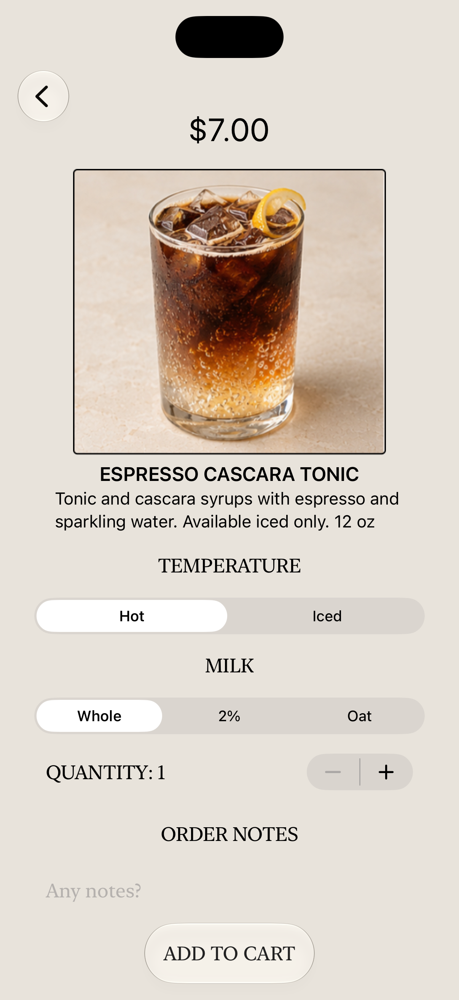
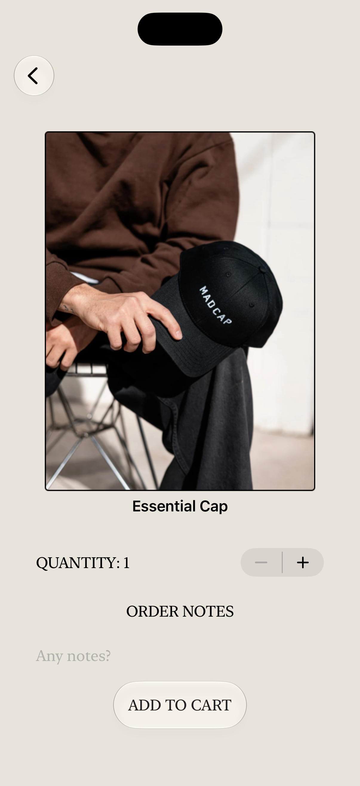
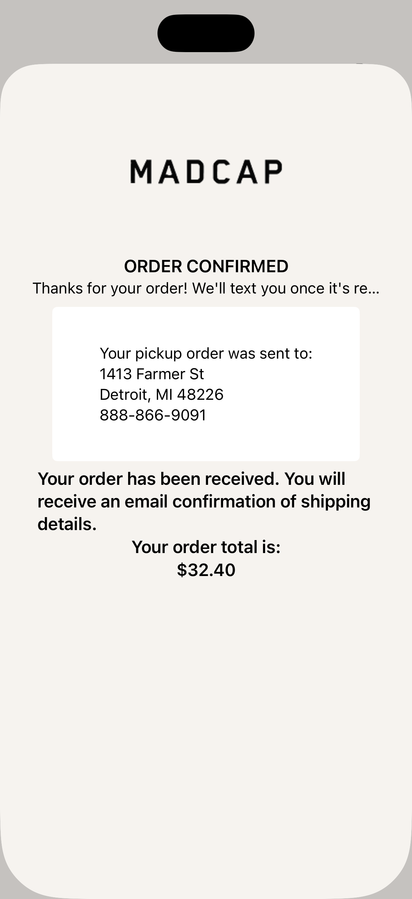

# MobileCoffeeOrder ☕

A SwiftUI coffee-ordering prototype inspired by Madcap Coffee. Browse drinks, food, merchandise, and brewing equipment, customize an item, and explore a sample order confirmation.

The app combines a warm neutral palette, serif typography, expandable menu panels, and horizontal product galleries to create a café storefront experience.

## Features

- **Browse the menu:** Explore filter coffee and espresso, espresso with milk, signature drinks, tea, and draft beverages and food.
- **Explore the store:** Browse merchandise, coffee equipment, and packaged coffee.
- **Customize an item:** Choose hot or iced for supported menu categories and whole, 2%, or oat milk in the espresso-with-milk category.
- **Adjust quantity and notes:** Select 1–10 units and add special instructions.
- **Add to cart:** Keep selected products in a shared, in-memory cart.
- **View sample order details:** Open the cart button to see a confirmation sheet for the most recently added item, including quantity, notes, and a calculated total.

## Demo

These screenshots illustrate the prototype's design and ordering flow. Some details may differ from the current source.

### Storefront and menu browsing

<p>
  
  
</p>

### Drink and merchandise customization

<p>
  
  
</p>

### Sample order confirmation



## Built With

- **Swift** and **SwiftUI** for the app and interface
- **Observation** (`@Observable`) for shared cart state
- **NavigationStack** and sheets for navigation and presentation
- **Xcode asset catalogs** for product photography and branding
- Local Swift data collections for the menu and store catalog

## Getting Started

1. Clone the repository:

   ```bash
   git clone https://github.com/qfuggett/MobileCoffeeOrder.git
   cd MobileCoffeeOrder
   ```

2. Open `MadCap.xcodeproj` in Xcode.
3. Select the **MadCap** scheme and an iPhone simulator compatible with the project's deployment target.
4. Build and run with **⌘R**.

The checked-in project sets its iOS deployment target to **27.0**. Use an Xcode installation with the matching SDK and simulator runtime, or adjust the deployment target locally after checking API compatibility. For a physical device, configure your development team under **Signing & Capabilities**.

The app uses local data and bundled assets; no backend credentials or third-party package setup are required.

## Try the Demo Flow

1. Tap a menu category to reveal its products, then swipe horizontally to browse.
2. Select a drink or store item to open its detail screen.
3. Adjust the available options, quantity, and order notes.
4. Tap **ADD TO CART**.
5. Return to the storefront and tap the cart icon to view details for the last item added.

## Project Guide

- `MyApp.swift` — App entry point and shared cart setup.
- `ContentView.swift` — Storefront, product navigation, and confirmation sheet.
- `MenuPanel.swift` — Expandable menu panel component.
- `CustomizationView.swift` — Product details and customization controls.
- `Product.swift` — Product model, option types, product cards, and price calculation.
- `Cart.swift` — Observable cart containing selected products.
- `OrderConfirmationView.swift` — Sample confirmation and item summary.
- `Category.swift` — Menu and store category definitions and ordering.
- `Data.swift` — Local menu and store product catalog.
- `Assets.xcassets` — Product images and branding assets.

## Current Status

This is a prototype in development. The cart stores items for the current app session; a full cart list and checkout flow are still to be implemented. `CartView.swift` is currently a placeholder, and the search icon does not perform a search.

Confirmation messages are demonstration content. The app does not submit real orders, process payments, or send email or text notifications. The product total uses a fixed 8% demo tax calculation. Product-specific option restrictions, such as iced-only drinks, are not fully enforced.

## Credits

Created by **QueenTesa Fuggett**.

Madcap Coffee branding and product imagery are used as design references for this prototype. This project is an independent demo and is not presented as an official Madcap Coffee application.
